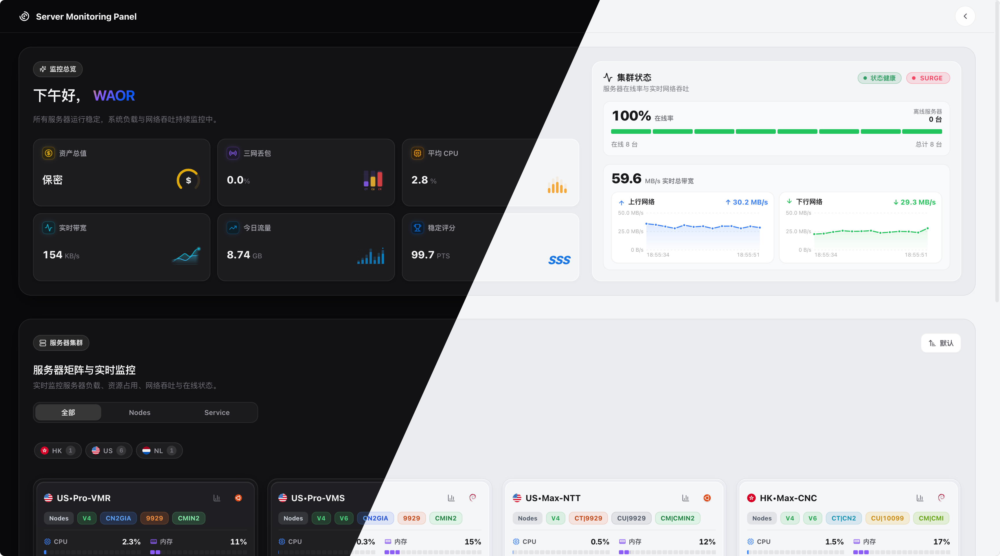
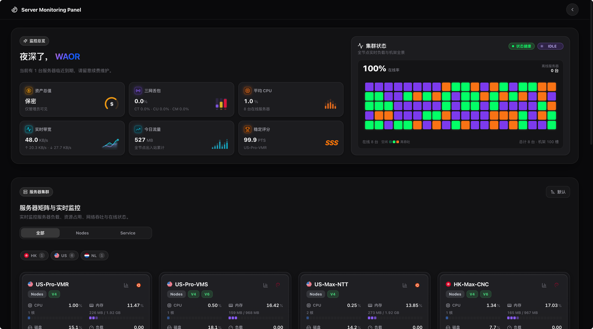
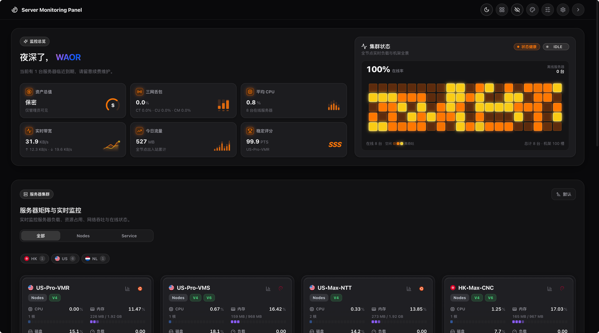
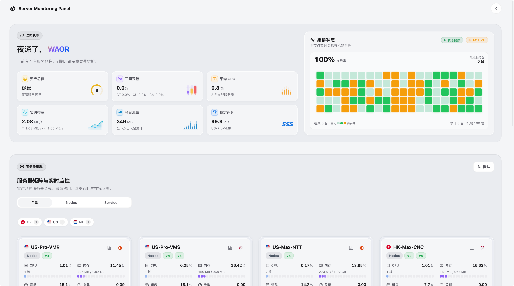
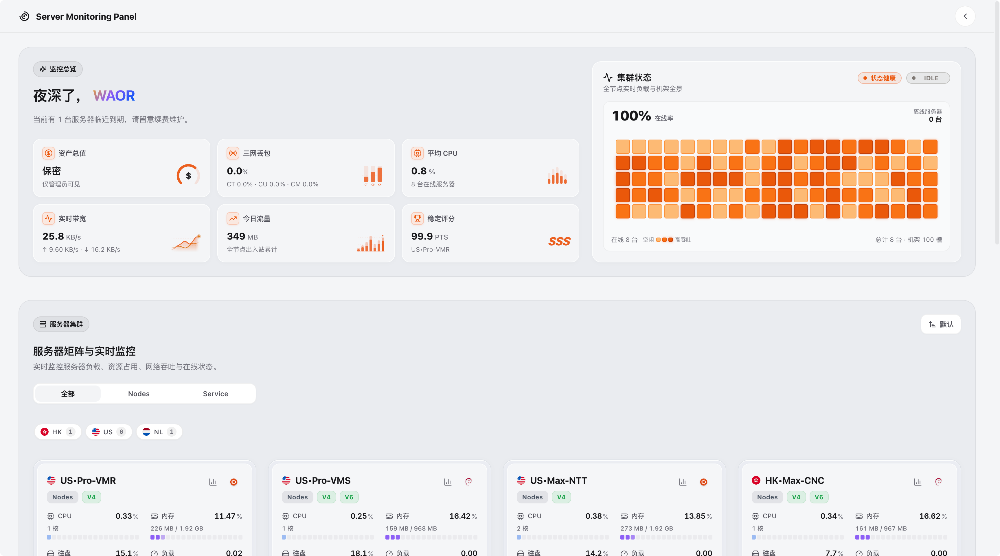
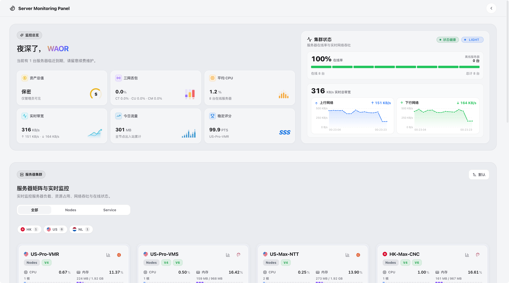
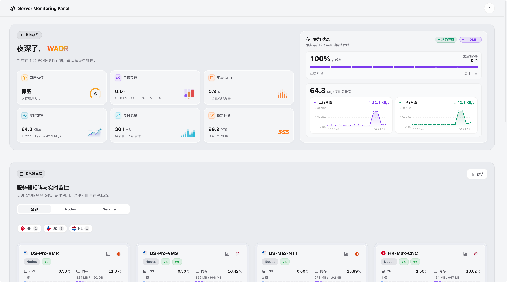
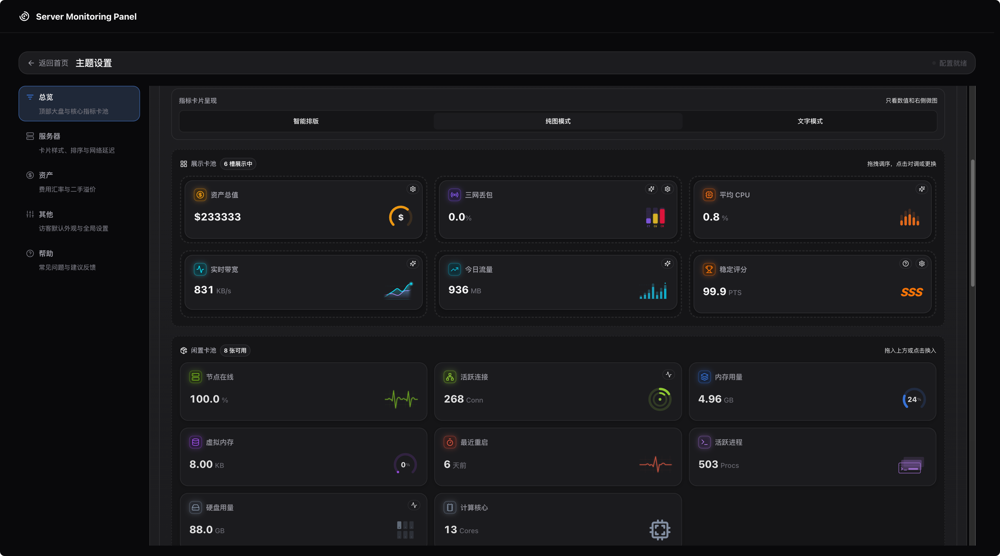
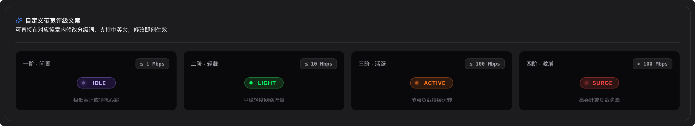

# SAO 系列探针主题 (SAO Series Probe Theme)

<p align="center">
  <strong>服务于探针数据呈现本身的高自由度模块化主题</strong>
</p>

<p align="center">
  <a href="https://github.com/WAOR/Komari-Theme-SAO">🌸 Komari 端</a> &nbsp;|&nbsp; 
  <a href="https://github.com/WAOR/CFSM-SAO">☁️ CFSM 端</a> &nbsp;|&nbsp; 
  <a href="https://github.com/WAOR/Monitor-SAO">⚡ 极简探针端</a>
</p>

<p align="center">
  
  
  
</p>

<p align="center">
  
</p>


### 🎨  2.0 全新特性
* **全新透白磨砂与通透质感**：2.0 版本确立了高通透半透明磨砂毛玻璃主题基调，彻底告别单薄生硬的平面表现，深浅模式卡片均极具立体感；
* **SAO 双层底座服务器卡片**：节点卡片引入全新立体双层底座形态，与LuminaPlus 经典卡片样式自由切换，信息聚合层次分明；
* **指标数据图形化呈现**：总览指标小卡全面接入高精度数据微图（实时带宽波浪双曲线、今日流量 7h 出入站柱状图、平均 CPU 频谱律动柱等），支持指标卡片微图动/静态模式切换；
* **三网丢包指标卡片**：电信、联通、移动分线透视，直观掌握骨干网丢包波动，右上角内嵌专属弹窗支持自由挑选参评节点；
* **资产多币种汇率换算**：支持选择 CNY、USD、EUR 等结算货币并自动计算剩余价值；
* **稳定评分卡片**：基于丢包+抖动偏离+晚高峰突增算法的线路稳定性评分卡片，客观呈现过去24小时的服务器线路稳定性评分并进行排名。


---

### 🎨  1.0 特性
* **首页流光幻彩用户昵称**：问候语搭载动态渐变流光昵称，Komari 端自动同步后端账户，CFSM 与 Monitor 端支持登录后点击直接快速编辑；
* **中性碳黑与护眼浅灰**：纯正中性深色底色；浅色模式降低视觉眩光；
* **资产数据一键防窥**：敏感节点费用与资产总值默认隐藏，支持顶栏快捷键一键安全截图分享；
* **iOS 灵动岛全景融入**：安全区色彩自然漫延至状态栏与灵动岛背后，彻底消除顶部色彩断层。
---

### 🎮 集群状态双形态自由切换
支持在主题管理中根据集群规模与偏好自由切换集群状态呈现方案：

#### 〰️ 「SAO 趋势大盘」
专为小集群打磨的集群状态呈现方案：
* **分段式在线健康指示格**：单机一格映射存活状态，全站在线率一目了然；
* **SVG 实时吞吐波形**：轻量贝塞尔实时曲线，内置自适应标尺算法，流畅呈现瞬带宽状态；

#### 🔲 「SAO 方格矩阵」
专为大规模集群打造的高密度俯瞰热力看板：
* **整屏机架热力**：突破趋势大盘的单行在线绿限制，单屏容纳上百台机器，溢出无缝垂直滚动；
* **实时吞吐动态梯级**：单机方格根据对应服务器的实时吞吐呈现动态色彩梯级变幻；
* **联动主题配色方案**：方块色彩联动主题配色方案，更多个性化配色将随版本持续扩充；
* **微型点阵画板与开场预设**：配备 20×5 微型像素 DIY 画板，内置多种点阵图案、文字等常用预设，支持一键载入、支持用户自定义绘制开场图案跨设备漫游同步；
* **开屏激光扫光动效**：主题内置多款开屏动效设计并将持续更新，动效结束呼吸聚能后平滑切入实时集群数据；
* **闲置机位灵动呼吸填充**：可选开启闲置插槽模拟数据，周期性随机变幻速率，保持整屏矩阵饱满生动。

---

### 🏷️ 节点高级彩色标签定制 (Radix Colors)
各探针原生支持的色彩非常有限。SAO 主题在前端层面全量引入并支持了完整的 [Radix UI Colors](https://www.radix-ui.com/themes/docs/theme/color) 调色板，可在后台为线路或节点自由指定丰富的高定专属色彩：

* **🌸 Komari 端指定语法**：在后台节点标签中填写 `标签名<颜色>`，多标签用分号 `;` 分隔：
  ```text
  CN2GIA<Blue>;9929<Tomato>;CMIN2<Grass>;精品网<Amber>
  ```
* **☁️ CFSM 端指定语法**：在后台节点备注中填写 `标签名-颜色`，多标签用英文逗号 `,` 分隔：
  ```text
  CN2GIA-Blue,9929-Tomato,CMIN2-Grass,精品网-Amber
  ```
* **⚡ 极简探针端说明**：因当前极简探针官方服务端尚未提供节点标签（Tags）字段，该功能暂处于冻结等待期，待服务端后续开放后主题将第一时间跟进适配。
* **支持的色彩池**：全量支持 Radix UI 规范色彩名（不区分大小写）：
  > `Tomato` · `Red` · `Ruby` · `Crimson` · `Pink` · `Plum` · `Purple` · `Violet` · `Iris` · `Indigo` · `Blue` · `Cyan` · `Teal` · `Jade` · `Green` · `Grass` · `Lime` · `Mint` · `Sky` · `Amber` · `Yellow` · `Orange` · `Gold` · `Bronze` 等。

---

## 📸 视觉效果预览

### 🎬 动态效果实录 (Video Demo)

https://github.com/user-attachments/assets/0540209f-442d-4977-b872-ff04821e0843

---

### 🖥️ 桌面端集群全景 (Desktop Overview)

#### 1. 深色极客体系 (Dark Mode)
| EVA 初号机配色 · 方格矩阵 | 命运石之门配色 · 方格矩阵 |
| :---: | :---: |
|  |  |

#### 2. 浅色典雅体系 (Light Mode)
| 经典标准配色 · 方格矩阵 | 命运石之门配色 · 方格矩阵 |
| :---: | :---: |
|  |  |

| 经典标准配色 · 趋势大盘 | EVA 初号机配色 · 趋势大盘 |
| :---: | :---: |
|  |  |

---

### ⚙️ 主题设置与 DIY 高级定制 (Customization & Layouts)

| SAO 指标卡池（自由点选与拖拽重排） | SAO 方格机架矩阵与开屏动效设定 |
| :---: | :---: |
|  |  |

| 实时带宽评级徽章自定义 (DIY) |
| :---: |
|  |

---

### 📱 移动端精细响应式适配 (Mobile Experience)

| 移动端全息方块矩阵呈现 (EVA 配色) | 移动端多功能主题设置抽屉 |
| :---: | :---: |
|  |  |

---

## 🧩 多端特性对比矩阵

| 核心特性 / 维度               |                         🌸 Komari 端                          |                      ⚡ 极简探针端                       |                  ☁️ CFSM 端                   |
| :---------------------- | :----------------------------------------------------------: | :------------------------------------------------: | :------------------------------------------: |
| **方格矩阵**                |                             ✅ 支持                             |                        ✅ 支持                        |                     ✅ 支持                     |
| **趋势大盘**                |                             ✅ 支持                             |                        ✅ 支持                        |                     ✅ 支持                     |
| **磨砂玻璃卡片**              |                             ✅ 支持                             |                        ✅ 支持                        |                     ✅ 支持                     |
| **带宽评级徽章自定义**           |                             ✅ 支持                             |                        ✅ 支持                        |                     ✅ 支持                     |
| **双层底座服务器卡片**           |                             ✅ 支持                             |                        ✅ 支持                        |                     ✅ 支持                     |
| **指标卡专属动态微图**           |                             ✅ 支持                             |                        ✅ 支持                        |                     ✅ 支持                     |
| **微图动/静态模式切换**          |                             ✅ 支持                             |                        ✅ 支持                        |                     ✅ 支持                     |
| **首页流光幻彩昵称**            |                           🤖 自动读取                            |                     ✏️ 点击编辑保存                      |                  ✏️ 点击编辑保存                   |
| **三网丢包指标卡片**            |                             ✅ 支持                             |                        ✅ 支持                        |                     ✅ 支持                     |
| **资产多币种汇率换算**           |                             ✅ 支持                             |                        ✅ 支持                        |                     ✅ 支持                     |
| **稳定评分指标卡片 & 天梯榜**      |                           🏆 独占支持                            |                      ❌ 受限暂未支持                      |                   ❌ 受限暂未支持                   |
| **指标小卡数量**              |                          ✅ 14 张指标卡片                          |                     ✅ 13 张指标卡片                     |                  ✅ 12 张指标卡片                  |
| **主题配色方案**              |                           ✅ 持续更新中                            |                      ✅  持续更新中                      |                   ✅  持续更新中                   |
| **开屏动效 & 点阵画板**         |                             ✅ 支持                             |                        ✅ 支持                        |                     ✅ 支持                     |
| **主题更新感知提示**            |                             ✅ 支持                             |                        ✅ 支持                        |                     ✅ 支持                     |
| **地区标签惯性拖动 & 超限自动循环滚动** |                             ✅ 支持                             |                        ✅ 支持                        |                     ✅ 支持                     |
| **光柱色彩 & 延迟丢包阈值自定义**    |                             ✅ 支持                             |                        ✅ 支持                        |                     ✅ 支持                     |
| **主题设置随改随存**            |                             ✅ 支持                             |                        ✅ 支持                        |                     ✅ 支持                     |
| **资产隐蔽保护**              |                             ✅ 支持                             |                        ✅ 支持                        |                     ✅ 支持                     |
| **节点标签自定义色彩**           |                     🏷️ 指定色彩 (`标签<颜色>`)                      |                     ⏳ 待后端开放接口                      |              🏷️ 指定色彩 (`标签-颜色`)              |
| **部署方式**                |                     主题商店搜索一键安装 / 上传 ZIP                      |                 填入仓库地址一键安装 / 上传压缩包                 |             主题商店搜索一键启用 / 仓库地址安装              |
| **项目地址**                | [Komari-Theme-SAO](https://github.com/WAOR/Komari-Theme-SAO) | [Monitor-SAO](https://github.com/WAOR/Monitor-SAO) | [CFSM-SAO](https://github.com/WAOR/CFSM-SAO) |

---

## 🏷️ 多端版本号规范与维护机制

**SAO 系列探针主题**目前涵盖 [Komari-Theme-SAO](https://github.com/WAOR/Komari-Theme-SAO)、[CFSM-SAO](https://github.com/WAOR/CFSM-SAO) 与 [Monitor-SAO](https://github.com/WAOR/Monitor-SAO) 三个版本。为兼顾**跨端核心功能演进的一致性**与**单一探针平台差异化适配的灵活性**，三端主题版本号遵循以下维护约定：

```text
v 主版本 . 次版本 . 修订版本  (规范格式: vX.Y.Z)
   │        │        │
   │        │        └── 单端专属补丁/小修小补（Patch，各端按需独立递增，不追求一致）
   └────────┴─────────── 跨端核心功能与架构重塑（Major.Minor，三端严格对齐）
```

- **前两位（`X.Y` - 主版本与功能代际）**：代表跨端通用的新功能、重大特性与架构重塑（如全新主题配色、动效升级、自定义光柱、设置后台重构等）。三端主题在此层级保持**严格对齐**，确保多平台用户享有相同的功能体验与视觉质感。
- **末位（`Z` - 单端修订补丁）**：代表针对特定探针后端的专属修复、接口兼容与小修小补。
  - 由于各探针服务端（Komari、CFSM、极简探针）的底层技术栈、接口规范与更新节奏各不相同，当某一端需要单独修复平台缺陷或优化特定机制时，仅独立递增该端的末位补丁号；
  - 其他未受影响的端保持既有稳定版本，**日常维护期各端末尾修订号不追求刻意对齐**；
  - **跨端汇合机制**：当后续推出跨端通用的新特性、迭代至下一个功能代际（如递增次版本号进入新的 `X.(Y+1).0`）时，三端版本号将再次同步对齐，末位补丁号归零。

---

## 🚀 安装与部署

SAO 主题已上架三端各自的主题生态，均提供便捷的一键安装或离线部署支持：

### 🌸 Komari 端
* **方式一：主题商店一键安装（推荐）**  
  进入 Komari 管理后台「主题商店」，搜索 **SAO** 点击安装并启用。
* **方式二：手动上传安装包**  
  前往 [Komari-Theme-SAO Releases](https://github.com/WAOR/Komari-Theme-SAO/releases) 下载主题压缩包，在后台主题管理中上传启用。

### ⚡ 极简探针端 (Monitor-Probe)
* **方式一：仓库地址一键安装（推荐）**  
  在极简探针管理后台「主题设置」页面，复制填入极简探针主题仓库地址 `https://github.com/WAOR/Monitor-SAO` 即可一键拉取安装。
* **方式二：手动上传安装包**  
  前往 [Monitor-SAO Releases](https://github.com/WAOR/Monitor-SAO/releases) 下载最新打包产物 `theme.tar.gz`，在后台主题设置页面上传启用。

### ☁️ CFSM 端 (CF-Server-Monitor)
* **方式一：主题商店一键启用（推荐）**  
  登录 CFSM 后台前往「主题商店」，搜索 **SAO** 主题点击启用即可。
* **方式二：手动添加仓库地址（锁定特定版本）**  
  在「主题商店」中填入自定义地址安装：
  - 追踪最新发布版：`https://github.com/WAOR/CFSM-SAO/tree/dist`
  - 锁定特定 Commit：`https://github.com/WAOR/CFSM-SAO/tree/<40位CommitSHA>`

---

## 💖 致谢

感谢以下优秀开源项目与社区贡献者的付出：
* **[stqfdyr/komari-theme-Lumina](https://github.com/stqfdyr/komari-theme-Lumina)**：初代优雅主题开创者。
* **[shanyang242/Komari-Theme-LuminaPlus](https://github.com/shanyang242/Komari-Theme-LuminaPlus)**：出色的功能增强分支与架构设计。
* **[volcano-1025/CFSM-Theme-LuminaPlus](https://github.com/volcano-1025/CFSM-Theme-LuminaPlus)**：CFSM 平台的早期移植探索。
* **[guboysky/LuminaPlus](https://github.com/guboysky/LuminaPlus)**：Monitor 探针平台的移植尝试。
* **[Montia37/komari-theme-purcarte](https://github.com/Montia37/komari-theme-purcarte)**：动态背景视频的设计与参考素材。
* **[komari-monitor/komari](https://github.com/komari-monitor/komari)**、**[huilang-me/CF-Server-Monitor](https://github.com/huilang-me/CF-Server-Monitor/)** 与 **[monitor-probe/monitor](https://github.com/monitor-probe/monitor)**：探针监控服务端的作者及社区维护者。

---

## 📄 开源许可证

SAO 系列主题基于 [MIT License](LICENSE) 开源发布。
